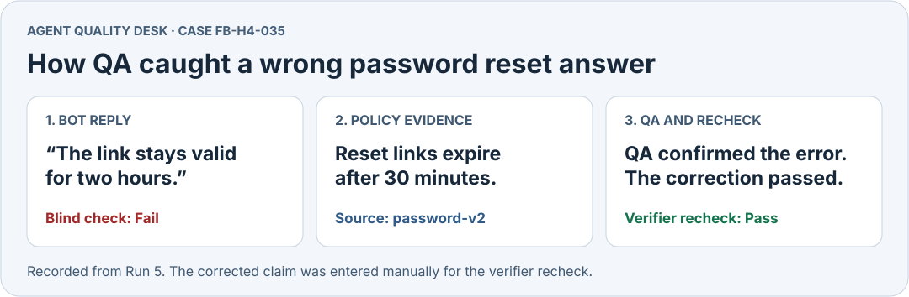

# Agent Quality Desk

A quality gate for AI support bots. It checks what the bot told a customer against the evidence: policy, account records, action logs and tool results. It catches replies that invent policy, promise things nobody approved, skip a required handoff or leave the customer without a usable answer, so a QA team can review exceptions instead of samples.

**Mayank Udaywal** is the author and product owner of this portfolio project. Fieldbook is fictional. Holdout v2 includes adapted Bitext sample data. The [data notice](data/holdout_v2/NOTICE.md) covers attribution and the public copy.

> **Status: Phase 0 FAILED (Run 5, 15 Nov 2026).** The blind test on holdout v4 and stress v4 met 11 of the 16 gated metric rules and all 5 evidence rules. Five metric rules failed, so the frozen pass rule says FAIL. The result is published as it came out. The pass rule was fixed in advance and nothing was retuned after the labels were seen, which is what makes the failure credible. See [PHASE0_RUN5_REPORT.md](PHASE0_RUN5_REPORT.md).

## See a QA decision in 60 seconds



[Case study](CASE_STUDY.md) · [Recorded trace](pipeline/trace_FB-H4-035.json) · [Full evaluation](PHASE0_RUN5_REPORT.md)

## Replay the result (one command)

Python 3.10 or later, standard library only. No API key, no network, no install.

```sh
python3 pipeline/replay.py
```

This checks that the locked code, prompts, schemas, wrapper and rubric match the lock. It also checks that every saved model request and reply is bound to its hash. It then rescores the saved replies and confirms the result reproduces the published blind scores file byte for byte (SHA-256 `a7b2b1f6…31a5`), and prints `REPLAY OK`.

Other runs include `python3 pipeline/replay.py runs/regression_L8` (pre-blind consistency) and `python3 pipeline/replay.py runs/regression_L8_flagged` (earlier run with a flagged audit).

Reproduce the Phase 0 decision from the released labels:

```sh
python3 pipeline/evaluate5.py pipeline/runs/blind_v4/published_scores.json \
  a7b2b1f66b840ee5b0dbab11ed60ac57545455d7974e9e775051dd6a918c31a5 \
  data/holdout_v4/holdout_v4_labels.json data/stress_v4/stress_v4_manifest.json evaluation/evidence.json evaluation/out.json
```

It prints `PHASE 0 FAIL` and exits 1. The output matches `evaluation/evaluation_blind_v4.json` and the tester's own `evaluation_blind_v4_tester.json`, which are byte-identical.

Run `python3 pipeline/trace_case.py` to see one case from flag to verified fix. See [What the trace shows](#what-the-trace-shows).

## Evaluation setup

- Claude was used to extract claims and assess tone, handoff context and resolution. The session reported model ID `claude-opus-5-5`. Snapshot and sampling settings were unavailable.
- ChatGPT (Codex) was used to prepare test cases, conduct two independent AI labeling passes, and verify the release. The labeling record preserves both sets of ratings and resolves any differences before freezing.
- The evaluator applied the pre-set Phase 0 rules to the recorded scores and frozen labels. The labels were released after verification of the blind scores hash.
- This is an offline replay of a synthetic prototype. Production cost and live latency remain unmeasured.

## How it works

1. **Extraction (model).** A model reads each bot reply and lists every claim it makes, typed as policy term, price, offer, account fact, completed action, promise, handoff or procedure. It also lists what the customer needs. It runs twice, independently.
2. **Verification (deterministic code).** Each claim is checked against its own source: the policy in force, the invoice tool, the action log or the help content. Claims found by only one pass are checked too. A claim with no source is a defect, or a referral to QA when the records are incomplete.
3. **Judgement (model).** Tone, handoff context and whether the reply resolves the need are judged twice, with the verified claims as input.
4. **Combination.** Each conversation is checked for policy and fact accuracy (c1), escalation (c2), sensitive data handling (c3), resolution (c4), AI disclosure (c5) and tone (c6). Verdicts include pass, fail, referral and knowledge base conflict.

Checks 1 to 3 are critical. The full scoring contract is in [the PRD](pipeline/rubric/PRD_v8_rev7.md).

## Running the prototype

The replay and evaluator run locally on the bundled inputs and open no network listener. Use the bundled demo inputs. The archived agent launcher uses predictable temporary paths and assumes a private session. The file watcher records access and the agent instructions describe the allowed actions. A shared or production environment would need access controls and private per-run directories.

## Repository layout

| Path | Contents |
| :---- | :---- |
| `pipeline/` | Locked code, prompts, schemas, wrapper, launcher and PRD (rubric). Test suites. `replay.py`, `trace_case.py` |
| `pipeline/runs/blind_v4/` | The blind run: lock, v4 conversations, 52 saved requests (with text copies), 52 replies, index, both audit reports, watcher log, published scores |
| `pipeline/runs/regression_L8/` | Pre-blind two-pass consistency run under the same lock (gate passed, audits clean) |
| `pipeline/runs/regression_L8_flagged/` | The first L8 consistency run, kept on record. Its extraction audit window was flagged and the run was replaced |
| `pipeline/runs/lock_record.json` | Every lock from L1 to L8 and its outcome |
| `data/` | Synthetic Fieldbook data: holdout v2, v3 and v4 with labels, stress suites v3 and v4 with manifests, the 27-case regression set |
| `evaluation/` | Evaluation evidence file, the evaluator's output, the console log, and the tester's copy for comparison |
| `PHASE0_RUN5_REPORT.md` | The Phase 0 run report against the frozen criteria |
| `CASE_STUDY.md` | One-page case study |

## Tests

From `pipeline/`. Every suite passes on the frozen code:

| Command | Result |
| :---- | :---- |
| `python3 fixtures7.py` | 72 of 72 |
| `python3 -c "import fixtures_store as f; r=f.run_all(); print(sum(x['pass'] for x in r), len(r))"` | 39 of 39 |
| `python3 test_harness.py` | 25 of 25 |
| `python3 test_evaluate5.py` | 34 of 34 |
| `python3 test_e2e.py` | 6 of 6 |

## What the trace shows

FB-H4-035 is a holdout case. The bot said a password reset link stays valid for two hours. The policy in force (password-v2) says 30 minutes.

- **Flag:** the blind run failed check 1 on that claim, with the policy as evidence.
- **QA disposition:** the released label confirms it as a problem.
- **Fix:** the reply is corrected.
- **Recheck:** the locked verifier passes the corrected claim.

The corrected claim in the recheck is entered by hand, using the same fields the model recorded. It is not a model output, and the script says so.
